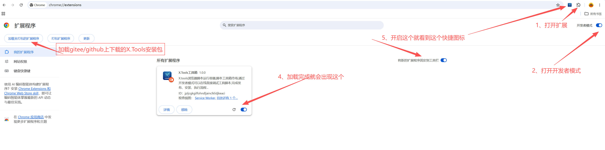
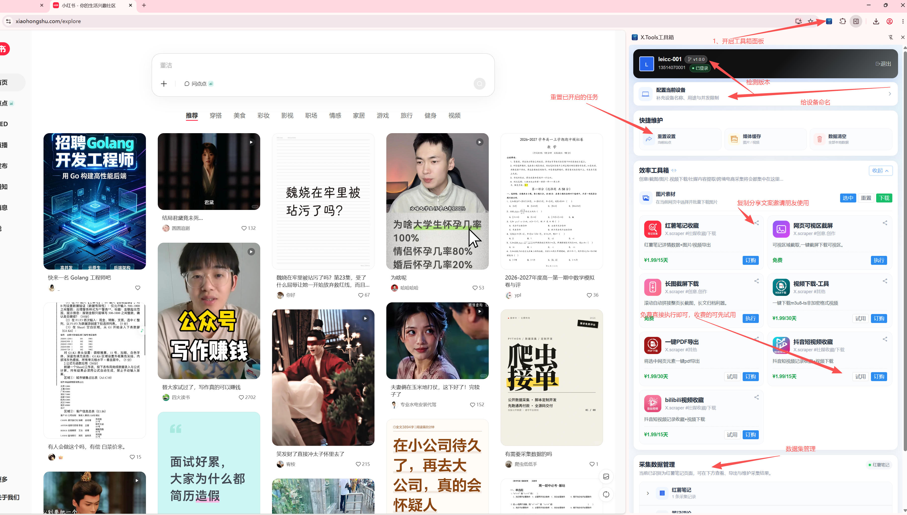

# X.Tools 插件工具箱

## 把浏览器变成你的随身工具箱

看到喜欢的就收藏，想要的就一键下载，收藏想要的数据。

X.Tools 把所有零散的小需求，收进浏览器右上角那一个小方块里。

## 安装说明

## 使用说明

## 当前已有功能

- B站视频下载
- 抖音视频下载
- 小红书图片 / 视频 / 笔记 / 评论采集
- 一键选中元素 HTML 导出
- 视频下载
- 更多功能持续更新中……

## 下一个工具，由你决定

下一个工具是什么？说出你的想法，我来帮你实现。 关注公众号：研发栈   发消息留言

## 开发者邀请

### 会写插件代码？来市场里摆个摊

一个小工具不用很大，能解决一个小问题就够。

官网地址：

https://hobbyconnect.cn/